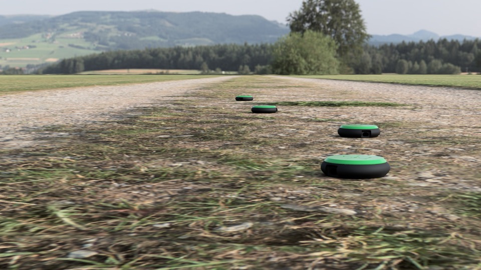
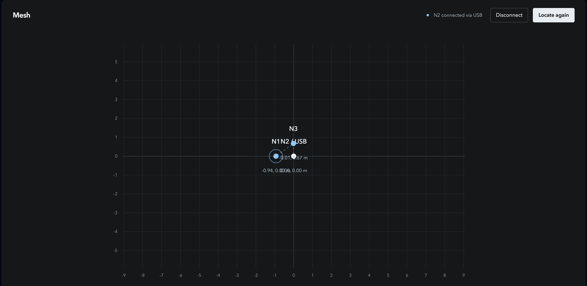

# DropMesh

A network of sensor discs that finds its own position without GPS.

**Built for the European Defense Tech Hackathon Copenhagen 2026.**



*The deployment concept. Each disc measures distances to its neighbours over ultra-wideband radio.*

## Why we built it

A sensor reading needs a location to be useful. When GPS is unavailable or
jammed, a deployed sensor network can lose the positions that give its data
meaning. Measuring every sensor's position by hand also takes time and limits
how quickly a network can be deployed.

We built DropMesh to explore a simpler deployment: place the nodes, let them
measure the distances between each other, and use those measurements to work
out where they are. The longer-term goal is a network of inexpensive sensor
discs that locates itself and relays readings to a base station. Known anchor
positions would tie the network's relative map to the outside world.

## What we built during the hackathon

The working prototype uses three Seeed Studio XIAO RP2350 boards connected to
Qorvo DWM3000 UWB radio modules. The nodes exchange ranging messages, measure
their pairwise distances, and calculate their own relative positions in firmware.
The browser connects to one node over USB to display the reported layout.

- UWB time-of-flight ranging between physical nodes.
- A relative map calculated on the microcontrollers.
- A browser interface for USB connection, positioning, recording and replay.
- Stationary measurements for examining range bias and position jitter.
- A printable disc enclosure with a twist-lock lid.



*The browser displays positions reported by the nodes. One USB connection is enough to view the three-node demo.*

## How positioning works

The radios measure how long messages take to travel between nodes. The firmware
uses the resulting distances to solve the triangle formed by the three nodes.
N1 defines the origin, N2 defines the positive x axis, and N3 takes the positive-y
solution. The browser translates that map so the node connected over USB appears
at the origin.

This gives the prototype a relative coordinate frame. It does not establish a
geographic location or compass heading, and the mirror side remains ambiguous.
The firmware withholds coordinates when measurements are missing, stale, or
inconsistent, or when the triangle is too poorly conditioned to solve reliably.

## Current limits and next steps

This is an early hardware prototype built during the hackathon. Hardware captures
demonstrate ranging and position reporting, but range bias depends on placement.
The current filter reduces stationary jitter. Motion tracking and 10 cm accuracy
have not been established.

The pitch's goals of roughly 50 cm positioning accuracy and months of battery
life remain targets. Larger networks, positioning from known anchors, sensor
data relay, and battery-powered operation need further implementation and field
testing. Operating without GPS does not make the UWB link immune to jamming.

## Run the hardware demo

Requires Node.js 22.18+ and pnpm. Development was verified with Node.js 26.

```sh
pnpm install
pnpm dev
```

Open <http://127.0.0.1:5192> in Chrome or Edge. Power all three configured nodes,
place them in a triangle, and connect one over USB. Close any other serial reader,
then press **Connect USB** and **Locate nodes**. All nodes need power; only one
needs a USB data connection.

The [firmware guide](node-firmware/README.md) covers wiring, firmware builds,
board configuration, calibration and hardware measurements. The web interface
requires real nodes for live positioning.

## Project files

- [`demo/`](demo/): browser interface, recording analysis and browser tests.
- [`node-firmware/`](node-firmware/): firmware, hardware tools and tests.
- [`node-firmware/calibration/`](node-firmware/calibration/): calibration records and measurement evidence.
- [`media/Body.stl`](media/Body.stl) and [`media/Lid.stl`](media/Lid.stl): printable enclosure parts.
- [`media/`](media/): logo, concept render and demo screenshot.

## Development checks

```sh
pnpm test
pnpm build
pnpm test:firmware
pnpm exec playwright install chromium
pnpm test:browser
```

Firmware host tests require a C/C++ compiler and Python 3. Browser tests use
mocked Web Serial without accessing physical boards. Set
`PLAYWRIGHT_CHROMIUM_EXECUTABLE_PATH` to reuse an existing Chromium executable.

The static build is written to `dist-demo/`. Run `pnpm preview` to serve it locally.
Cloudflare asset configuration is in `wrangler.jsonc`; deployment is a separate
action.

## Team

Built by Bertram Agerholm, Noah Schenk, Morten Thorhauge and Aske Mogensen,
students at the Technical University of Denmark.
